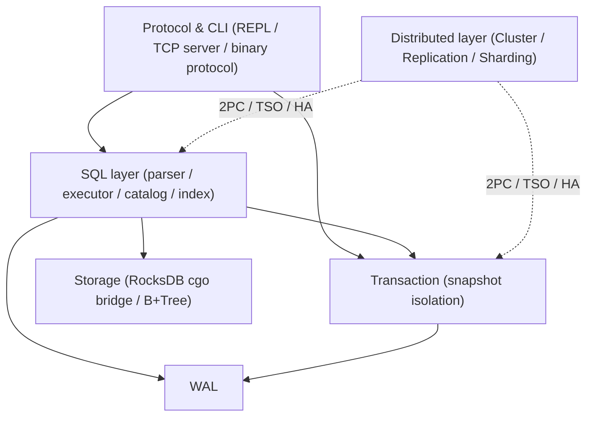
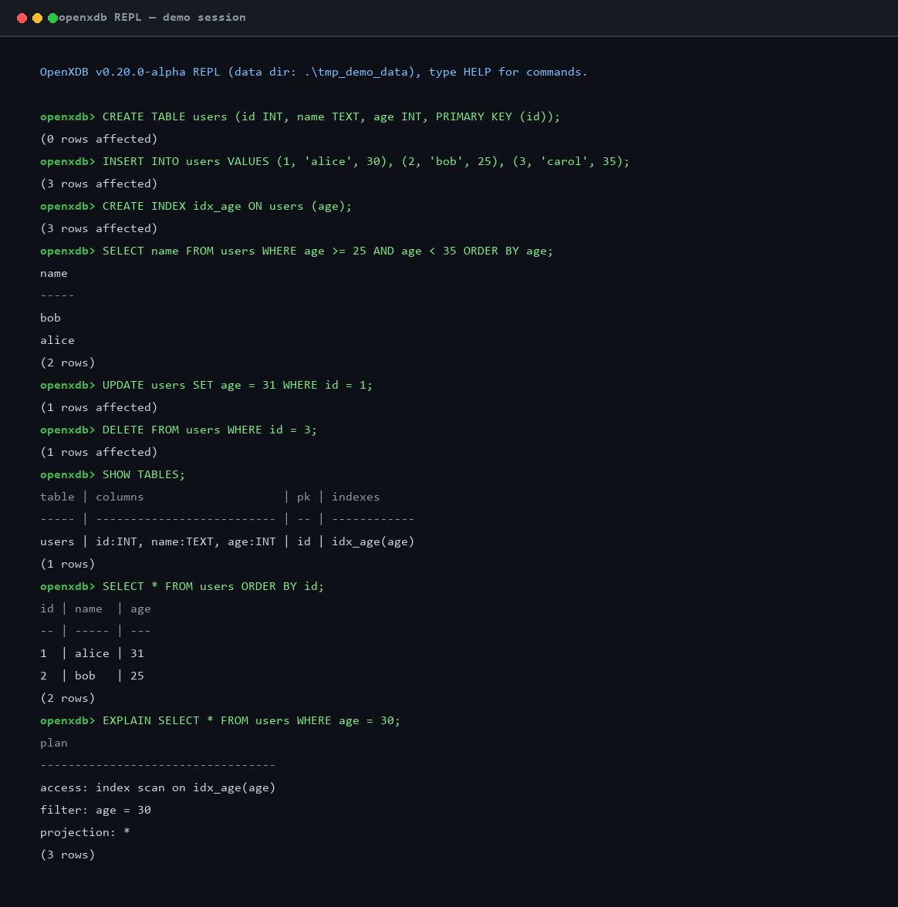

---
AIGC:
    Label: "1"
    ContentProducer: 001191440300708461136T1XGW3
    ProduceID: 60bbebc6db5a512fc5d10abafd5f3b57_bdd83564c86c11f18b7f525400393706
    ReservedCode1: WfMTyove99YV06WZh34T2L4i2JX5tj63b/O9AN9CZjk+asOZEkUIqgygBB62QdF5dTd544TxS+ntrC0pXXbwBrzwtfq+bYqYC8mjce/vKjthCv4xsNe116dQvRi9R2F7ZM+UO2m7/gBp2wgtu/2glu7tMqzb8xYdZIOKjgoRx+dpWl46pMY+hKtNLy4=
    ContentPropagator: 001191440300708461136T1XGW3
    PropagateID: 60bbebc6db5a512fc5d10abafd5f3b57_bdd83564c86c11f18b7f525400393706
    ReservedCode2: WfMTyove99YV06WZh34T2L4i2JX5tj63b/O9AN9CZjk+asOZEkUIqgygBB62QdF5dTd544TxS+ntrC0pXXbwBrzwtfq+bYqYC8mjce/vKjthCv4xsNe116dQvRi9R2F7ZM+UO2m7/gBp2wgtu/2glu7tMqzb8xYdZIOKjgoRx+dpWl46pMY+hKtNLy4=
---


# OpenXDB

*从零自研的单机/分布式关系型数据库内核（Go + RocksDB），含 WAL、事务、SQL、复制、分片、2PC、HA、备份恢复等完整能力。*

[](https://github.com/zhengkuanhua/openxdb/actions/workflows/ci.yml)
[](https://github.com/zhengkuanhua/openxdb)
[](LICENSE)
[](https://github.com/zhengkuanhua/openxdb/releases)
[](https://github.com/zhengkuanhua/openxdb)
[](https://github.com/zhengkuanhua/openxdb)

OpenXDB 是从零自研的单机/分布式关系型数据库内核（Go + RocksDB），定位于学习与工程实践并重的开源数据库项目。内核自底向上实现了基于 RocksDB（cgo）的存储引擎、追加式 WAL、快照隔离事务与带二级索引的 SQL 子集，并在此基础上完整交付复制、分片、多节点集群、分布式 2PC 写、HA 故障转移、分布式事务（TSO + 分布式快照隔离）、备份恢复与 PITR、客户端驱动（JDBC/Python）、运维工具链、认证权限（审计 + RBAC）与生态导出（JSON/Parquet）等能力，当前版本 **v1.16.0**。

## 快速开始

### 1. 编译

```sh
# Linux/macOS：一键构建 + 测试（自动探测 RocksDB 安装）
./scripts/build.sh --test
# Windows：
powershell -ExecutionPolicy Bypass -File scripts\build.ps1 -RunTests
```

手动编译需提供 RocksDB 的 include / lib 目录（详见下文 Build 一节）：

```sh
export CGO_CFLAGS=-I<rocksdb>/include
export CGO_LDFLAGS=-L<rocksdb-build> -lrocksdb
go build ./...
```

### 2. 启动服务

```sh
openxdb init --data-dir ./data    # 初始化数据目录
openxdb start --data-dir ./data   # 启动 TCP 服务（默认端口 7788）
openxdb start --data-dir ./data --mysql-port 3306   # 可选：启用 MySQL wire protocol 兼容监听（mysql CLI / go-sql-driver / JDBC 直连）
openxdb repl --data-dir ./data    # 或直接进入本地 REPL
```

### 3. 连接数据库

- **REPL**：`openxdb repl --data-dir ./data`
- **Python 驱动**（PEP 249）：

```python
import openxdb
conn = openxdb.connect(host="127.0.0.1", port=7788, user="root")
cur = conn.cursor()
cur.execute("SELECT name FROM users WHERE age >= 25")
print(cur.fetchall())
```

- **JDBC 驱动**：

```java
Class.forName("openxdb.jdbc.OpenXDBDriver");
Connection conn = DriverManager.getConnection(
    "jdbc:openxdb://127.0.0.1:7788", "root", "");
```

### 4. 第一个示例

```sql
CREATE TABLE users (id INT, name TEXT, age INT, PRIMARY KEY (id));
INSERT INTO users VALUES (1, 'alice', 30), (2, 'bob', 25), (3, 'carol', 35);
CREATE INDEX idx_age ON users (age);
SELECT name FROM users WHERE age >= 25 AND age < 35 ORDER BY age;
```

## 特性亮点

| 维度 | 能力 |
|------|------|
| **Storage** | RocksDB cgo 桥存储引擎 + 内存 B+Tree 参考实现（LSM comparator） |
| **WAL** | 追加式 WAL + 崩溃重放恢复，group commit 批量 fsync；自动 checkpoint/truncate（安全位点截断，长期运行 wal.log 大小受控） |
| **事务** | 本地快照隔离事务 + 分布式事务（TSO 全局时间戳 + 2PC + 分布式快照隔离） |
| **SQL** | SELECT/JOIN/GROUP BY/子查询/CTE/窗口函数（含多列 ORDER BY）/upsert/视图/物化视图（增量刷新）/触发器（行级语义）/存储过程（受限子集）/ALTER 列级/CREATE DATABASE/INSERT INTO SELECT 等 |
| **RBAC 与安全** | 细粒度角色/权限体系、审计日志、TLS 加密传输（AutoTLS + 证书热轮换）、监控告警（规则级 webhook） |
| **集群** | 复制（异步/半同步/同步）、region 分片、多节点 2PC、HA 故障转移（epoch 脑裂防护 + 回迁自动化）、自动分裂与负载均衡 |
| **备份恢复** | 一致性快照备份（并发分片）、幂等恢复、LSN 基 PITR、分布式一致备份、备份调度/远程 push-pull |
| **生态导出** | JDBC/Python 驱动（pipeline 批量）、mysqldump 导入（全选项）、binlog CDC、JSON/Parquet 流式导出（大结果集分片写） |

## 架构总览

```
Protocol / CLI (REPL · TCP server · JDBC/Python 驱动 · MySQL wire protocol 兼容监听 --mysql-port)
        │
        ▼
     SQL 层 (Parser / Executor / Catalog / Index)
        │
        ▼
 Txn（快照隔离） ◄──► WAL（追加式日志 · 重放恢复）
        │
        ▼
 Storage (RocksDB cgo 桥 / 内存 B+Tree)
```


## Documentation

- **产品手册（中文）**: [docs/product_manual_zh.md](docs/product_manual_zh.md)
- **产品手册（英文）**: [docs/product_manual_en.md](docs/product_manual_en.md)
- **变更记录**: [CHANGELOG.md](CHANGELOG.md)
- **发布说明**: [RELEASE_NOTES.md](RELEASE_NOTES.md)
- **已知限制**: [KNOWN_LIMITATIONS.md](KNOWN_LIMITATIONS.md)
- **设计文档**: [docs/](docs/)（T1–T42 / M 系列 / E 系列）
- **基准实验**: [docs/experiments/](docs/experiments/)（E1–E5）

## 版本状态与完整特性

### 版本状态

**v1.0.0（2026-10-16 正式发布）**：T1–T42 / M1–M21 / E1–E5 全部里程碑完成，全仓回归测试全绿。近期交付：**M18** MySQL 兼容（prepared statement + information_schema 虚拟视图）、**M19** 生态导出（JSON / Parquet）、**M20** 分布式深化（T33 同步/半同步复制、T34 跨节点 DDL、T35 分布式备份一致性）、**M21** 商业加固（T36 TLS 合规、T37 监控告警、T38 真实用户验证）、**E5** 标准 sysbench OLTP / TPC-C 基准对齐（Python 驱动等价实测）、**T40** SQL 能力簇（MAX/MIN 聚合、算术表达式、SELECT DISTINCT）、**T41** DDL 兼容（IF NOT EXISTS + CREATE TABLE AS SELECT）、**T42** INSERT INTO SELECT。

**v1.1.0（2026-10-22 发布）**：MySQL wire protocol 兼容补全 —— **COM_CHANGE_USER / COM_STMT_SEND_LONG_DATA** 协议命令与参数类型扩展（`--mysql-port` 监听下 mysql CLI / JDBC / go-sql-driver 直连更完整）；**mysqldump 导入扩展**（IMPORT MYSQLDUMP 类型与语句覆盖增强）；**SQL 边缘分支清理**（parser / executor 边界用例、DECIMAL 精度舍入语义等）；**fixregions 工具重构**与测试补全；**文档同步**（变更记录 / 发布说明 / 产品手册对齐 v1.1.0）。

**v1.2.0（2026-10-22 发布）**：**显式事务跨 region 写** —— 显式事务内 2PC 路径补全（行锁保持至 COMMIT，消除 read-modify-write lost update）；**HAVING + GROUP BY 语义补全**；**窗口函数 ROWS / RANGE 帧**扩展；**外键 ON UPDATE CASCADE / SET NULL**；**存储过程子集增强**（IF / 循环 / CASE / 递归深度上限）；**docs 同步**。

**v1.3.0（2026-10-23 发布）**：**全局会话锁消除** —— 以会话级细粒度锁替代全局锁（`e.mu` → `sess.mu`），并发度显著提升；**备份 / 导入并行化** —— `BACKUP CONCURRENCY k` 分片并行与 mysqldump 导入并行；**Serializable 隔离级别** —— `SET TRANSACTION/SESSION` 切换，提交前 rw-antidependency 检测（读集 ∩ 活跃/窗口写集）返回 `ErrConflict`；**行协议语义修订** —— NULL（`\N`）与空串严格区分、RFC4180 换行引用、DECIMAL 行协议导入拒绝小数位 > 4；**仓库清理**与 `.gitignore` 防再跟踪。

**v1.4.0（2026-10-23 落地）**：**工程债与稳定性** —— waitEverUp 心跳竞态防护与路由视图契约对齐（`c77bdab`）；cmd/fixregions 离线路由修复工具纳入版本库并补全测试（`b7796fc`）；D 混合事务性能复测回正（会话锁消除收益确认 +1032.5%，清理热路径调试残留）；根目录调试残留清理与 `.gitignore` 加固。

**v1.5.0（2026-10-23/24 落地）**：**协议与吞吐** —— 客户端 pipeline 协议（Python/JDBC 驱动批量流水线执行，`e1515b8`）；行协议 NULL/空串二义消除与单元格换行/反斜杠转义（`d26695b`）；mysqlproto 高级协议测试正式化（`06f37d4`）。

**v1.6.0 阶段二（2026-10-24 落地）**：**SQL/兼容补齐收官** —— P1-2 MySQL wire binlog/mysqldump 全选项推进（COM_REGISTER_SLAVE / COM_BINLOG_DUMP 订阅位点语义、整库 dump 导入、`db.tbl` 反引号前缀保留）与复制协议测试正式化（T44）；P1-3 存储过程受限子集补齐（DECLARE/IF/WHILE/LOOP/FOR/REPEAT/游标/OUT 参数回写）；P2-4 HA 回迁自动化（补偿帧回灌旧主未复制段、旧主识别新主 epoch 重置基线、binlog 损坏走全量对齐兜底）；P1-1 补充 `db.tbl` 库前缀解析与空表 SUM/AVG 类型化零值语义。

**v1.6.0 阶段一（2026-10-24 落地）**：**P1 核心 SQL 硬缺口补齐** —— ① `ALTER TABLE` 列级操作补全（新增 `MODIFY COLUMN`：列类型/默认值修改，存量行按类型转换规则重写，DECIMAL/INT/TEXT/DATE/BLOB 互转，索引/PK 列类型变更校验）；② **CREATE DATABASE / 库级管理**（`CREATE DATABASE [IF NOT EXISTS]`、`DROP DATABASE`（级联删库内表）、`SHOW DATABASES`、`USE <db>`（会话级默认库 `Session.CurrentDB`）；库目录元数据 `m:databases` 持久化；表名支持 `db.tbl` 前缀，未限定归默认库 `default`，存量数据零迁移兼容；DML/DDL 全链路库前缀解析与库存在校验；`information_schema` 保留虚拟库语义）；③ **多列窗口扩展**（`WindowSpec.OrderBy` 由单列扩展为多列 `[]*OrderBy`，`ORDER BY col [ASC|DESC], ...` 多列键比较，RANK/DENSE_RANK 多列同键处理，RANGE 帧多列 ORDER BY 按首列键域计算）。对应测试见 `pkg/sql/t39_sql_subset_test.go`，`go build ./...` 与 `go test ./pkg/sql` 全绿。

**v1.7.0（2026-10-24 落地）**：**HA 全量对齐兜底联动** —— SQL 层 region push 接通回迁降级路径，主从数据最终一致兜底（`5389303`）；空表 AVG 语义转正与 M6 心跳时序竞态修复随版本回归。

**v1.8.0（2026-10-24 落地）**：**触发器行级语义** —— `FOR EACH ROW` 触发、`NEW`/`OLD` 行引用、触发器体回滚与递归策略（`f7bb1f4`）。

**v1.9.0（2026-10-24 落地）**：**物化视图增量刷新** —— 基表变更跟踪、`CONCURRENTLY` 快照交换、依赖链管理（`b73bb9a`）。

**v1.10.0（2026-10-25 落地）**：**HA 脑裂防护生产化** —— `ha.epochEnabled` 默认开启（quorum 保持默认关闭，评估结论见 docs/HA_BRAIN_SPLIT_DESIGN.md §5.5）；三节点组网脑裂演练 TestP1BrainSplitDrill；HA_BRAIN_SPLIT_DESIGN.md Draft→已落地 v1.0；backup_schedule 测试补齐与 dup_repro 并发正确性测试入库（`7aba976`）。

**v1.11.0（2026-10-25 落地）**：**商业生态增强与文档对齐** —— T32 生态导出流式化（Parquet 多 RowGroup、CSV 分块扫描即时写盘，内存有界）；T37 告警规则级 webhook 通知（异步 POST、URL 白名单校验）；T36 TLS 证书热轮换（AutoListener SetConfig + ReloadTLS）；README/KNOWN_LIMITATIONS 同步至 v1.10.0、quorum 边界结论登记（HEAD `7e8ed42`）。

**v1.12.0（2026-10-25 落地）**：**性能与精度优化** —— ① P1 协议解析优化：全量对话边界 bufio 读覆层（减少逐字节系统调用）+ COM_QUERY 多语句在线切分执行（引号/注释内分号安全，`serverStatusMoreResults=0x0008`，单语句行为兼容）；② P2 DECIMAL 高精度扩展：4 位小数 → 按列声明 scale 可配置精度（值对象 DS 字段、跨 scale 对齐比较/舍入、行协议与 JSON 导出联动）；③ P2 备份导入提速：IMPORT BATCH 语义强化（事务分批提交、失败回滚边界清晰）；④ P2 组提交默认开启评估：WAL 组提交默认开（Append 仅写缓冲、SyncUpTo 合并 fsync），E5 实测 TPC-C tpmC 13.5→41.0、OLTP write 0.93→1.25 TPS。

**v1.13.0（2026-10-25 落地）**：**服务端并发与 E5 pipeline 化** —— ① P1 服务端多连接并发处理：协议读侧 REPLSession 改 reader goroutine 预读 + 有界 channel + 主循环顺序执行，消除单连接逐命令串行读等待，会话级隔离不变、既有 server/mysqlproto 测试与单节点部署零回归；② P1 E5 脚本 pipeline 化：bench_oltp.py / bench_tpcc.py 事务内语句改客户端 pipeline 批量发送（整事务一次往返）；③ P1 E5 受控复测：干净重置 + 3 轮取中位数，TPC-C tpmC 41.00→78.00 / tpm_total 88.50→164.50（提升约 90%）、OLTP read 0.40 / write 0.40 / read-write 0.40 TPS（read 受引擎聚合/范围查询执行开销制约，SQL 执行层零改动），连接超时 errs 根因修复（--timeout 120s + 连接级异常重建，3 轮 errs=0 / reconnects=0）；④ P2 文档同步（README / KNOWN_LIMITATIONS 至 v1.13.0、DEV_PLAN 2026Q7 补 v1.13.0 排期标完成，DEV_PLAN 不入库）。

**v1.14.0（2026-10-25 落地）**：**只读 SELECT 并行 + WAL 组提交定时窗口** —— ① P0 只读 SELECT 并行：REPLSession pipeline 批内对连续 autocommit 只读 SELECT 并发执行（worker pool，默认并发 8、批上限 64），响应按序重组消除队头阻塞；非只读/事务内/未鉴权语句即时中断退回串行；qc 查询缓存 Get/Put 由既有互斥锁并发控制；开关 `ro_parallel`（默认 on，SET ro_parallel=0 回退 v1.13.0 串行行为）；② P1 WAL 组提交定时窗口：SyncUpTo leader 路径在记录尾部后按窗口 sleep 再刷新最新已写末尾，事务稀疏时也合并 fsync；配置 `group_commit_window_ms`（默认 0.5ms，0=回退 v1.13.0 被动攒批，100µs~1ms 可配）；③ 全仓回归 22 包全绿，新增 server_roparallel_test.go（批序重组/开关回退/事务隔离/配置热切换）+ wal_test.go 组提交窗口测试（默认窗口/稀疏合并/关闭基线）+ P1 配置接线测试；④ E5 受控复测（8 连接 3 轮中位数）：OLTP read 0.40→0.43 / write 0.40→0.43 / read-write 0.40→0.43 TPS，TPC-C tpmC 78.00→85.50（详情见 docs/experiments/E6_v1140_ro_parallel_wal_groupcommit.md）。

**v1.15.0（2026-10-26 落地）**：**SQL 执行层四项优化** —— ① W1 Scan 快路径（txn 无未提交写时快照直透，跳过全量物化 + 重建排序）；② W2 COUNT(*)/COUNT(1) 快速路径（无 WHERE/GROUP 等时走存储层 RangeCounter 逐 region 计数求和）；③ W3 SELECT 列投影下推（按需解码列，JOIN/子查询/星号保守全列回退）；④ W4 ORDER BY 索引顺序扫描免排序 + DISTINCT 相邻去重免排序（单列二级索引/主键 + 运行时 O(n) 已序验证）。E5 受控复测（每轮 prepare 重置 + 3 轮取中位数，8 连接）：OLTP read 0.38 / write 0.40 / read-write 0.40 TPS、TPC-C tpmC 81.50，单语句专项 COUNT(*) 全表 **580ms → 5.18ms（约 103-112 倍）**、全表扫描单列 532.33ms、ORDER BY 主键 548.51ms 与 DISTINCT 619.88ms 免排序生效（详情见 docs/experiments/E5_standard_bench_alignment.md）。

**v1.16.0（2026-10-28 落地）**：**SQL 执行内核并发模型优化 + WAL 持久化收敛** —— ① C1 WAL 组提交增强（单等待者免窗口 + 批量刷盘）；② C2 Begin 快照创建锁外化（ID/序号仍单调）；③ C3 ro_parallel 下沉 executor + 显式事务只读并行；④ C4 提交应用流水线化/组提交；⑤ C5 cgo 扫描拷贝优化；⑥ C6 连接内语句 pipeline / 快照复用（autocommit 顶层纯只读 SELECT 共享快照）；⑦ **WAL 自动 checkpoint/truncate**（`wal_auto_checkpoint` 默认 on、`wal_checkpoint_interval_ms` 默认 60000、`wal_checkpoint_max_mb` 默认 64；安全位点 safe=min(synced,applied)、截断前 Flush 落 SST，长期运行 wal.log 大小受控、崩溃恢复严格等价）。E5 受控复测（每轮 prepare 重置 + 3 轮取中位数，8 连接）：OLTP read **10.37** / write **8.33** / read-write **8.15** TPS（QPS 145.13 / 33.33 / 146.70，errs=0 / reconnects=0），较 v1.15.0 TPS 提升约 **20-27 倍**、QPS 提升约 **22-27 倍**，**达成验收目标（TPS≥1.5、QPS≥30）**；TPC-C 5 仓 tpmC **254.00**（较 v1.15.0 的 81.50 提升约 3.1 倍）（详情见 docs/experiments/C7_e5_controlled_retest.md、docs/experiments/WAL_auto_checkpoint_truncate.md）。

### 完整特性

- **Storage** — RocksDB-backed key-value storage via a thin C++ cgo bridge (`pkg/storage/rocksdb`), plus a pure-Go in-memory B+Tree (`pkg/storage/btree`) used as reference and comparator.
- **WAL** — append-only write-ahead log with replay recovery (`pkg/wal`).
- **Transactions** — local ACID transactions with snapshot isolation; read-your-writes merge, tombstones, and point/range scan (`pkg/txn`).
- **SQL subset** — `CREATE/DROP DATABASE [IF NOT EXISTS]` / `SHOW DATABASES` / `USE <db>` (session-level default db, `db.tbl` qualified names fall back to `default`), `CREATE/DROP TABLE` (types INT/TEXT/DATE/DECIMAL/BLOB), `ALTER TABLE ADD/DROP/RENAME/MODIFY COLUMN` + `RENAME TABLE` + `ADD/DROP INDEX` (MODIFY rewrites existing rows by type-conversion rules), `CREATE/DROP INDEX`, `INSERT`, `SELECT` (WHERE, ORDER BY, LIMIT, aggregates COUNT/SUM/AVG, JOIN, GROUP BY, subqueries, BETWEEN, IN), window functions (multi-column `PARTITION BY`/`ORDER BY`), `UPDATE`, `DELETE`, `EXPORT`/`IMPORT` (CSV + JSON Lines + Parquet), `PREPARE`/`EXECUTE`/`DEALLOCATE PREPARE` (parameterized statements with `?` placeholders), `SET @var`/`SELECT @var` user variables, read-only `information_schema` views (`schemata`/`tables`/`columns`/`statistics`); expressions `LIKE` (`%` / `_`) and `CASE WHEN`; ops statements `SHOW TABLES`, `SHOW INDEX FROM t`, `EXPLAIN <SELECT>`, slow queries via `SET SLOW <ms>` and `SHOW SLOWQUERIES` (`pkg/sql`).
- **Fine-grained RBAC (M17)** — role system (`CREATE ROLE` / `DROP ROLE [IF EXISTS]` / `SHOW ROLES`, `GRANT ROLE '<role>' TO '<user>'` / `REVOKE ROLE ... FROM '<user>'`, `SHOW GRANTS FOR '<user>'`) + extended privileges (`GRANT/REVOKE <priv> ON DATABASE <db> TO/FROM '<user>'|ROLE '<role>'`, `GRANT/REVOKE <priv> ON <table> (<col>, ...) TO/FROM ...`, role-targeted table/database grants), aggregated privilege checks (table direct ∪ database ∪ role inheritance for SELECT/INSERT/UPDATE/DELETE) with column-level checks, DROP USER/TABLE/ROLE cascade cleanup (`pkg/sql/rbac.go`, `pkg/sql/authz.go`, `m:dbgrants`/`m:colgrants`/`m:roles`/`m:userroles`).
- **Secondary indexes** — backfill on creation, automatic maintenance on DML, and query optimization for equality/range scans and ORDER BY (`T6`).
- **Server & CLI** — REPL and TCP server (`cmd/openxdb`), binary protocol over TCP (`pkg/server`).
- **Ops toolchain (T20)** — `openxdb doctor` health checks: data dir & WAL integrity, RocksDB open, `m:tables`/`m:regions` metadata consistency & route self-consistency, binlog readability & LSN (read-only `PeekLastLSN`), optional online port/PING & slow-query checks, human-readable or `--json` report with exit codes 0=pass / 1=warn / 2=error; `openxdb stats` metrics: active connections (server session counter), table count, region count & route distribution, slow query count, binlog LSN (+ optional two-sample growth via `--interval`), table or `--json` output backed by the new `SHOW STATS` statement; one-click deploy scripts `scripts/deploy.ps1` / `scripts/deploy.sh` (parameterized `-DataDir`/`-Port`, init + start + health self-check + deployment summary) (`cmd/openxdb/doctor.go`, `cmd/openxdb/stats.go`, `pkg/server`, `pkg/sql`, `pkg/replication`, `pkg/db`, `scripts/`).
- **Replication (M2)** — master-follower async replication: commit-hook binlog (independent append-only file, monotonically increasing LSN), replicator push with per-slot resume, follower idempotent apply, PING/PONG heartbeats with offline detection (`pkg/replication`, `pkg/txn`, `pkg/db`).
- **Sharding (M3)** — logical sharding on the single-node kernel: RegionInfo metadata persisted as `m:regions`, Router with half-open `[StartKey, EndKey)` boundary semantics, region-prefixed physical keys (`r` + regionID:8B + inner key), cross-region point/range/full-table queries via range expansion + merge, and SPLIT / LIST REGIONS / LOCATE REGION management; default single-region shape keeps pre-sharding behavior unchanged (`pkg/sharding`, `pkg/sql`, `pkg/db`).
- **Multi-node cluster (M4)** — first distributed cluster: node topology with NodeInfo registry (`ADD NODE` / `SHOW NODES`), handshake and liveness via the reused M2 PING/PONG heartbeat protocol, cluster route table (region → node, `ASSIGN REGION ... TO NODE` / `SHOW REGION ROUTES`), and cross-node SELECT forwarding: non-local regions are executed via TCP on their owning node and merged back into the existing executor semantics (frames 16-21, byte-level physical-key scan to avoid package cycles); remote-region writes are rejected until the distributed write transaction cluster (2PC) lands (`pkg/cluster`, `pkg/sql`, `pkg/db`).
- **Distributed write / 2PC (M5)** — cross-node write atomicity on the M4 cluster: autocommit INSERT/UPDATE/DELETE (incl. CSV IMPORT) that touch both local and remote regions are executed as a two-phase commit — the coordinator applies local ops, PREPAREs remote participants (ops persisted under `m:2pc:*` for crash recovery), commits locally, then idempotently COMMITs all participants; any PREPARE failure or local commit failure ABORTs the whole statement with understandable errors (`TXN_PREPARE_FAILED` / `TXN_COMMIT_ABORTED` / `TXN_COMMIT_UNCERTAIN`). Protocol frames 22-27 extend the M4 framing; single-node deployments never enter the 2PC path (zero regression) (`pkg/cluster`, `pkg/sql/2pc.go`, `pkg/db`).
- **HA / Failover (M6)** — high availability on the M4/M5 cluster: heartbeat-driven failure detection marks a node `down` (PING/PONG timeout, `OnDown` callback), regions owned by the down node are automatically re-assigned to a live node (data caught up via a full replica scan + `REGION_PUSH`, replacing manual `ASSIGN REGION`), cross-node reads fail over transparently to the new owner (no client error), and in the replication link the follower auto-promotes to master when the old master is down (optional callback), keeping the write path available. Single-node and healthy-cluster paths stay untouched (zero regression) (`pkg/cluster`, `pkg/sql/ha.go`, `pkg/db/ha.go`).
- **Region auto-split & load balancing (M7)** — automatic region split on the write path: after DML commits the executor accumulates per-table write counters, and once the watermark reaches half the row threshold a real row-count check runs; a local region exceeding the threshold is split in half along its data midpoint inside the same transaction (existing rows re-routed, route table replaced, metadata persisted; boundary semantics reuse `EncodeRegionKey` — StartKey inclusive / EndKey exclusive, compatible with the M3 manual `SPLIT REGION`). Load balancing runs on demand (`BALANCE`) or on a periodic auto trigger, compares local region counts with the least-loaded live node, and migrates the largest region there while reads/writes stay available: the migration keeps the source route until a scan + `REGION_PUSH` has loaded the target (data + authoritative route view atomically persisted), then switches the local route and persists. Single-node mode reports `cluster not enabled` for `BALANCE` (zero regression) (`pkg/sql/balance.go`, `pkg/cluster`, `pkg/db`).
- **Distributed transactions / TSO (M8)** — global timestamp oracle for cross-node transactions: 64-bit physical-ms + 24-bit logical layout with strict monotonicity (clock-fallback safe) and batch issuance (GetBatch allocates contiguous ranges, remote clients cache a batch to amortize RTT); transaction-boundary Reset drops unconsumed cache so a new snapshot always reads from the authoritative sequence head; distributed snapshot isolation via version records (`m:ver:<key>:<commit_ts>`, key-first so per-key ranges stay contiguous) filtered by begin_ts/commit_ts globally comparable across nodes with cross-node passthrough; 2PC recovery hardening: coordinator persists CoordRecord (`m:2pc:coord:<txid>`) and on restart decides commit/abort (RecoverCoordinated2PC) and drives participants idempotently (`TXN_COMMIT_UNCERTAIN` completion) (`pkg/tso`, `pkg/cluster/tso.go`, `pkg/cluster/txn2pc.go`, `pkg/sql/executor.go`, `pkg/db`).
- **Backup / Restore (BR)** — logical backup and restore on the kernel: `BACKUP TO <path>` snapshots the full table catalog, all data rows and index keys, and region routing metadata on a single consistent snapshot (isolated from concurrent writes via `storage.Snapshot()`), plus the backup-point LSN, and writes a single transportable file (magic + version + JSON meta + per-segment CRC32 integrity checks, atomic tmp+rename); `RESTORE FROM <path>` validates version/integrity first, then rebuilds tables/data/indexes/routing with idempotent "drop-then-recreate" semantics for same-named tables (old rows/index residue cleared, catalog overwritten, whole restore runs in one transaction with full rollback); `RESTORE FROM <path> TO LSN <n>` replays binlog records after the backup point up to the target LSN (inclusive), providing the backup + binlog-replay PITR foundation (`pkg/sql/backup.go`, `pkg/sql`, `pkg/db`).
- **Prepared Statement (M18-B)** — `PREPARE <name> FROM '<sql>'` parses and caches parameterized SQL with `?` placeholders; `EXECUTE <name> [USING <arg>, ...]` binds session user variables (`@var`) or literals into the placeholder slots in order and executes the cached plan; `DEALLOCATE PREPARE <name>` frees the cache. Session-scoped semantics: same-name re-PREPARE overwrites, EXECUTE/DEALLOCATE of unknown names errors, argument count must match placeholder count, `@var` user variables set via `SET @x = <literal>` and read in `SELECT @x` / WHERE (`pkg/sql`).
- **Information Schema (M18-C)** — read-only virtual database `information_schema` exposing four views: `schemata` (SCHEMA_NAME=default), `tables` (TABLE_NAME/TABLE_TYPE/TABLE_ROWS), `columns` (TABLE_NAME/COLUMN_NAME/ORDINAL_POSITION/DATA_TYPE/IS_NULLABLE), `statistics` (TABLE_NAME/INDEX_NAME/SEQ_IN_INDEX/COLUMN_NAME/NON_UNIQUE). Supports case-insensitive column projection (`*` or explicit names), `WHERE <col> = <literal>` equality filters (AND-combinable), ORDER BY, qualified `default.information_schema.tables` FROM; any CREATE/DROP/INSERT/UPDATE targeting the virtual library is rejected (`pkg/sql/information_schema.go`).
- **Ecosystem export (M19)** — `EXPORT TABLE <t> TO '<path>' FORMAT CSV|JSON|PARQUET` (case-insensitive, CSV default). JSON emits JSON Lines (INT/DECIMAL as numbers, TEXT/DATE as strings, BLOB as uppercase hex, proper `"`/`\`/control-char escaping); Parquet is written by a self-contained minimal Parquet v1 writer (`pkg/export/parquet.go`: Thrift Compact-encoded FileMetaData, single row group, PLAIN/UNCOMPRESSED encoding, INT/DECIMAL→INT64 and TEXT/DATE/BLOB→BYTE_ARRAY), validated end-to-end by a mini reader roundtrip test (`pkg/export`, `pkg/sql/export_json.go`).

## Architecture

| Layer | Package | Responsibility |
|-------|---------|----------------|
| Protocol + CLI | `cmd/openxdb`, `pkg/server` | TCP server, REPL, binary protocol framing |
| Ops toolchain (T20) | `cmd/openxdb`, `pkg/server`, `pkg/sql`, `pkg/replication`, `pkg/db`, `scripts/` | `openxdb doctor` health checks (data dir/WAL/RocksDB/metadata/binlog/port/slow queries, exit 0/1/2), `openxdb stats` metrics (connections/tables/regions/slow queries/binlog LSN), `SHOW STATS`, deploy scripts (`deploy.ps1` / `deploy.sh`) |
| SQL | `pkg/sql` | Parser (recursive descent), executor (project/filter/sort/aggregate), metadata catalog, secondary index layer |
| Transaction | `pkg/txn` | Begin/commit/rollback, snapshot isolation, read-your-writes |
| Storage | `pkg/storage` | KV interface, key encoding; RocksDB engine and B+Tree engine |
| WAL | `pkg/wal` | Append-only log, replay recovery |
| Replication | `pkg/replication`, `pkg/txn`, `pkg/db` | Binlog store, master replicator (push + heartbeat), follower (idempotent apply), commit-hook wiring |
| Sharding | `pkg/sharding`, `pkg/sql`, `pkg/db` | RegionInfo metadata, Router key→region mapping, region-prefixed physical keys, cross-region query merge, split management |
| Cluster | `pkg/cluster`, `pkg/sql`, `pkg/db` | Node registry (m:nodes), handshake/liveness, cluster route table (region→node), cross-node SELECT forwarding + merge, region data load (REGION_PUSH) |
| Distributed write / 2PC | `pkg/cluster`, `pkg/sql/2pc.go`, `pkg/db` | Two-phase commit coordinator (ops grouping by region, prepare→local commit→participant commit/abort), participant prepare persistence + idempotent commit/abort markers (m:2pc:*), crash recovery (Recover2PC) |
| HA / Failover | `pkg/cluster`, `pkg/sql/ha.go`, `pkg/db/ha.go` | Heartbeat timeout → node down (OnDown callback), automatic region re-assignment (replica scan + REGION_PUSH to a live node), read failover via owner re-resolution (QUERY_REQ routed to new owner), replication master failover (follower auto-promote with optional callback) |
| Split & Balance | `pkg/sql/balance.go`, `pkg/cluster`, `pkg/db` | Write-path auto-split (DML counter watermark → real row-count check → data-midpoint split in the same txn), manual/auto load balancing (least-loaded live node target, largest local region migration via scan + REGION_PUSH while reads/writes stay available), cluster-not-enabled guard for single-node |
| Global Timestamp (TSO) | `pkg/tso`, `pkg/cluster/tso.go`, `pkg/db` | Global monotonic timestamp (64-bit ms+logical layout), batch issuance, overflow protection, transaction-boundary Reset |
| Snapshot Isolation (distributed) | `pkg/cluster/txn2pc.go`, `pkg/sql/executor.go`, `pkg/db` | Version records (m:ver), begin_ts/commit_ts global filtering, cross-node version passthrough |
| Backup / Restore | `pkg/sql/backup.go`, `pkg/sql`, `pkg/db` | Consistent-snapshot logical backup (single file, version + CRC32), idempotent restore (drop-then-recreate, transactional), binlog replay to target LSN (PITR foundation) |
| Data dir | `pkg/db` | Initialization, engine + WAL + txn manager wiring, crash recovery |



### Row / index key encoding

```
physical key: r{regionID:8B}{innerKey}
row key:    s{tableID:8B}{pk}                         (inner, M1)
index key:  i{tableID:8B}{indexID:8B}{idxVal}p{pk}   (inner, T6)
```

Every stored key carries a region prefix (`r` + 8-byte big-endian regionID); the inner key keeps the M1/T6 layout, so keys stay contiguous within a region and region boundaries are explicit. Index values use sort-friendly encoding: INT flips the sign bit (`v ^ 0x8000000000000000`), TEXT stays raw bytes, so byte order equals value order.

## Build

Requirements:

- Go 1.22+
- A C/C++ toolchain for cgo (e.g. MinGW-w64 on Windows, gcc/clang on Linux/macOS)
- RocksDB (tested with v11.8.1 source build, no third-party compression libs)

### Docker（v1.16.0 起提供）

仓库自带多阶段构建 `Dockerfile`：基于 `golang:1.27.1-bookworm` 编译 RocksDB 11.8.1 静态库（参数与 CI / build.sh 一致，无第三方压缩库）+ openxdb 二进制，`debian:bookworm-slim` 运行时，仅含二进制与 ca-certificates：

```sh
# 构建镜像
docker build -t openxdb:1.16.0 .

# 初始化数据目录并启动服务（数据持久化到卷 /data，默认端口 7788）
docker run --rm -v openxdb-data:/data openxdb:1.16.0 init --data-dir /data
docker run -d --name openxdb -p 7788:7788 -v openxdb-data:/data openxdb:1.16.0 start --data-dir /data
```

One-shot reproducible build scripts (auto-detect RocksDB install, then `go build` + optional `go test`):

```powershell
# Windows: build bin\openxdb.exe, verify go build ./..., run go test ./...
powershell -ExecutionPolicy Bypass -File scripts\build.ps1 -RunTests
# explicit paths:
powershell -ExecutionPolicy Bypass -File scripts\build.ps1 -RocksSrcDir C:\rocksdb-src -RocksBuildDir C:\rocksdb-build -RunTests
```

```sh
# Linux/macOS:
./scripts/build.sh --test
./scripts/build.sh --rocks-src /path/to/rocksdb-11.8.1 --rocks-build /path/to/librocksdb-dir --test
```

Manual cgo setup (equivalent, for custom toolchains):

```sh
export CGO_CFLAGS=-I<rocksdb>/include
export CGO_CXXFLAGS=-I<rocksdb>/include
export CGO_LDFLAGS=-L<rocksdb-build> -lrocksdb   # Windows: add -lshlwapi -lrpcrt4 -lws2_32

go build ./...
```

`pkg/storage/rocksdb` declares per-platform `#cgo` link flags (Windows
`-lwinpthread -lshlwapi -lrpcrt4 -lws2_32`, Linux `-lstdc++ -lpthread`,
Darwin `-lstdc++`), so only the RocksDB include/lib dirs need to be supplied
via `CGO_CFLAGS` / `CGO_LDFLAGS`.

## Demo

OpenXDB REPL session: create table, insert, secondary index, query, update, delete, explain.



## Quick start

```sh
# initialize a data directory
openxdb init --data-dir ./data

# local REPL
openxdb repl --data-dir ./data

# TCP server (default port 7788)
openxdb start --data-dir ./data [--port 7788]

# ops: health check + live metrics
openxdb doctor --data-dir ./data [--addr 127.0.0.1:7788] [--json]
openxdb stats [--addr 127.0.0.1:7788] [--interval 5] [--json]
```

## TLS 加密传输（P0）

主服务监听层支持 TLS：`--tls-cert` 与 `--tls-key` 同时提供时启用加密监听，否则保持明文监听（行为兼容）。复制端口（`--replica-port`）可另配 `--replica-tls` 启用 TLS（未启用保持明文）。

生成自签名证书（开发/测试用，生产请使用受信任 CA 签发的证书，勿将私钥提交仓库）：

```sh
# 方式一：openssl
openssl req -x509 -newkey rsa:2048 -nodes -keyout key.pem -out cert.pem -days 365 -subj "/CN=openxdb"

# 方式二：Go（单文件，无第三方依赖，写法见 pkg/server/server_tls_test.go）
go run gen_cert.go cert.pem key.pem
```

启动 TLS 服务（`--tls-cert` 与 `--tls-key` 必须同时提供，仅提供一个会报错退出）：

```sh
openxdb start --data-dir ./data --tls-cert cert.pem --tls-key key.pem
```

验证加密监听（自签名证书场景客户端不校验服务器名/证书）：

```sh
# openssl s_client 检查 TLS 握手
openssl s_client -connect 127.0.0.1:7788 -CAfile cert.pem

# 客户端 TLS 连接执行 PING/SET/GET（Go 客户端可参考 pkg/server/client.go 的
# Dial/InsecureTLSConfig；Python/JDBC 驱动按各自语言关闭证书校验即可）
```

REPL session:

```sql
CREATE TABLE users (id INT, name TEXT, age INT, PRIMARY KEY (id));
INSERT INTO users VALUES (1, 'alice', 30), (2, 'bob', 25), (3, 'carol', 35);
CREATE INDEX idx_age ON users (age);
SELECT name FROM users WHERE age >= 25 AND age < 35 ORDER BY age;
UPDATE users SET age = 31 WHERE id = 1;
DELETE FROM users WHERE id = 3;
```

## Tests

```sh
go test ./...
```

All packages pass: `cluster` (node handshake, query forwarding, heartbeat down, region push route learning, idempotent node re-register), `db` (incl. replication integration: binlog on commit, master-follower consistency, idempotent apply; incl. M4 two-node integration: cross-node full consistency, single-region assign; incl. M5 2PC integration: cross-node insert commit consistency, cross-node update/delete, prepare-failure abort rollback, single-node zero regression, crash recovery clears markers; incl. M6 HA integration: read failover after node down, automatic region re-assignment, promote-follower write continues, auto-promote on master down, data consistency after failover; incl. M7 split/balance integration: manual BALANCE migrates hot region, auto-balance periodic trigger, balance skips down node; incl. M8 distributed-txn integration: cross-node snapshot consistency, concurrent txn isolation, coordinator crash recovery commit/abort, single-node zero regression; incl. BR backup/restore integration: backup-restore round trip with explicit regions and secondary indexes, tampered backup rejected on restore, idempotent drop-then-recreate (stale rows/index residue cleared, index re-creatable), RESTORE TO LSN exact replay (backup point / +1 / +2 records), concurrent-write backup snapshot consistency, single-node zero regression), `replication` (binlog persistence/corruption, resume after reconnect, heartbeat timeouts), `server`, `sharding` (7 region-key/router/metadata cases), `sql` (incl. 9 secondary-index cases, 11 sharding integration cases, and M7 split/balance cases: auto-split on write threshold, manual SPLIT REGION boundary, split keeps secondary index consistent, cluster-not-enabled guard), `storage`, `storage/btree` (incl. randomized insert/delete invariant tests), `storage/rocksdb`, `tso`, `txn`, `wal`.

## Development log

Docs live in `docs/` (implementation records) and `docs/experiments/` (benchmarks):

- `T1_rocksdb_storage_impl.md`, `T2_wal_impl.md`, `T3_sql_layer.md`, `T3_txn_impl.md`, `T4_acid_notes.md`, `T5_cli_impl.md`, `T6_index_layer.md`, `T8_p0_sql_enhancements.md`, `T9_p1_csv_types.md`, `T10_p2_ops_expr.md`, `T11_m2_replication.md`, `T12_m3_sharding.md`, `T13_m4_multinode.md`, `T14_m5_2pc.md`, `T15_m6_ha.md`, `T16_m7_split_balance.md`, `T17_m8_dist_txn.md`, `T18_backup_restore.md`, `T19_client_drivers.md`, `T20_ops_toolchain.md`, `T21_sql_parser_fixes.md`, `T22_m9_online_ddl.md`, `T22_m9_query_cache.md`, `T22_m9_bulk_import.md`, `T22_m9_foreign_key.md`, `T22_m9_view.md`, `T23_m10_cte.md`, `T23_m10_window.md`, `T23_m10_upsert.md`, `T24_m11_user.md`, `T24_m11_grant.md`, `T24_m11_auth.md`, `T25_m12_join.md`, `T25_m12_order_limit.md`, `T25_m12_subquery.md`, `T33_m20_sync_semi_sync_replication.md`, `T34_m20_cross_node_ddl.md`, `T35_m20_dist_backup_consistency.md`, `T36_commercial_tls.md`, `T37_commercial_alerting.md`, `T38_commercial_real_user_validation.md`, `T40_sql_capability_cluster.md`
- `B2_group_commit.md` — write-path group commit (batch fsync)
- `E1_rocksdb_bench.md` — RocksDB write benchmark (E1a) + in-memory B+Tree comparison (E1b)
- `E2_rocksdb_fsync_bench.md` — RocksDB fsync sync-write benchmark (WAL sync=true, group-commit batch 1/10/100/1000) — see [E2 experiment](docs/experiments/E2_rocksdb_fsync_bench.md)
- `E3_sql_oltp_bench.md` — SQL OLTP mixed-load end-to-end benchmark (8:2 / 5:5, incl. 6.2 TPS root-cause diagnosis & tuning) — see [E3 experiment](docs/experiments/E3_sql_oltp_bench.md)
- `E4_stability.md` — long-run stability & durability validation (6-min trend + restart check) — see [E4 experiment](docs/experiments/E4_stability.md)
- `E5_standard_bench_alignment.md` — standard sysbench OLTP / TPC-C small-warehouse bench alignment (Python-driver equivalence for E5 bench; MySQL wire protocol compatible listener available since v1.1.0 via `--mysql-port`, real measured: OLTP read 1.73 TPS / write 0.93 / read-write 1.32, TPC-C tpmC 13.50, 0 errors) — see [E5 experiment](docs/experiments/E5_standard_bench_alignment.md)

## Roadmap

- [x] T1 storage layer (RocksDB cgo bridge)
- [x] T2 WAL
- [x] T3 SQL layer + transactions
- [x] T5 protocol + CLI
- [x] T6 secondary indexes + ordered scans
- [x] E1 storage benchmark: RocksDB (E1a) vs in-memory B+Tree (E1b) — see [E1 experiment](docs/experiments/E1_rocksdb_bench.md)
- [x] E2 fsync engine benchmark: sync write 747k TPS seq / 198k rand (batch=1000), group-commit batch sweep 181x vs per-key fsync — see [E2 experiment](docs/experiments/E2_rocksdb_fsync_bench.md)
- [x] E3 SQL OLTP end-to-end benchmark: 256.3 TPS (8:2) / 605.4 TPS (5:5), 0 errors after cgo MultiGet fix — see [E3 experiment](docs/experiments/E3_sql_oltp_bench.md)
- [x] E4 stability & durability: 6-min mixed load 307-385 TPS no degradation, restart COUNT(*) == 150466, probes HIT — see [E4 experiment](docs/experiments/E4_stability.md)
- [x] E5 standard bench alignment: standard sysbench/TPC-C direct attach not used for E5 (bench via Python PEP 249 driver equivalence; MySQL wire protocol compatible listener available since v1.1.0 via `--mysql-port`); real measured OLTP read 1.73 TPS/QPS 24.27, write 0.93/QPS 3.73, read-write 1.32/QPS 23.70 (8 threads × 60s), TPC-C 5-warehouse tpmC 13.50 / TPM 32.50, 0 errors (8 threads × 120s); fixed shared-session concurrency bug + arithmetic-expression/DISTINCT/DECIMAL-precision workarounds — see [E5 experiment](docs/experiments/E5_standard_bench_alignment.md)
- [x] W4 ADR + storage engine selection write-up — see [ADR-004](docs/W4_adr_engine_selection.md) and [why RocksDB](docs/blog_why_openxdb_rocksdb.md)
- [x] B2 batched commits on the write path (group commit / batch fsync) — see [B2 design](docs/B2_group_commit.md)
- [x] P0 SQL enhancements: JOIN / GROUP BY / FROM+IN subqueries / BETWEEN / session transactions (BEGIN/COMMIT/ROLLBACK) — see [T8 design](docs/T8_p0_sql_enhancements.md)
- [x] P1 CSV import/export + DATE/DECIMAL/BLOB types — see [T9 design](docs/T9_p1_csv_types.md)
- [x] P2 ops statements (SHOW TABLES / SHOW INDEX / EXPLAIN / slow queries) + expressions (LIKE / CASE WHEN) — see [T10 design](docs/T10_p2_ops_expr.md)
- [x] M2 replication: binlog + replicator + follower + heartbeat (async master-follower) — see [T11 design](docs/T11_m2_replication.md)
- [x] M3 sharding: RegionInfo metadata + Router + region-prefixed keys + cross-region queries (SPLIT / LIST REGIONS / LOCATE REGION) — see [T12 design](docs/T12_m3_sharding.md)
- [x] M4 multi-node cluster: node topology + handshake/liveness + cluster route table (region→node) + cross-node SELECT forwarding/merge (ADD NODE / SHOW NODES / ASSIGN REGION / SHOW REGION ROUTES) — see [T13 design](docs/T13_m4_multinode.md)
- [x] M5 distributed write path: cross-node transactions / 2PC (coordinator + participant, prepare persistence, idempotent commit/abort, crash recovery, single-node zero trigger) — see [T14 design](docs/T14_m5_2pc.md)
- [x] M6 high availability / failover: heartbeat-driven node-down detection + OnDown callback, automatic region re-assignment (replica scan + REGION_PUSH), read failover (QUERY_REQ re-routed to new owner), replication master failover (follower promote / auto-promote) — see [T15 design](docs/T15_m6_ha.md)
- [x] M7 region auto-split & load balancing: write-path auto-split (DML counter watermark → real row-count check → data-midpoint split in the same txn, boundary semantics reuse EncodeRegionKey), on-demand / periodic load balancing (BALANCE + auto-trigger, least-loaded live node target, largest region online migration via scan + REGION_PUSH with reads/writes uninterrupted, single-node reports cluster not enabled) — see [T16 design](docs/T16_m7_split_balance.md)
- [x] M8 distributed transactions enhancement: global TSO timestamp (64-bit ms+logical layout, batch issuance, overflow protection, transaction-boundary Reset), distributed snapshot isolation (version records keyed by row-key first, begin_ts/commit_ts global filtering, cross-node passthrough), 2PC recovery hardening (coordinator CoordRecord persistence, commit/abort decision on restart, idempotent participant completion) — see [T17 design](docs/T17_m8_dist_txn.md)
- [x] BR backup / restore: logical backup on a consistent snapshot (`BACKUP TO <path>`: full table catalog + data rows + index keys + region routing + backup-point LSN in a single transportable file with version & CRC32 checks, atomic write), idempotent restore (`RESTORE FROM <path>`: validate then drop-then-recreate same-named tables, rebuild data/indexes/routing in one transactional restore), LSN-based PITR foundation (`RESTORE FROM <path> TO LSN <n>`: binlog replay after the backup point up to the target LSN) — see [T18 design](docs/T18_backup_restore.md)
- [x] T19 client drivers: JDBC driver (`OpenXDBDriver` / `OpenXDBConnection` / `OpenXDBStatement` / `OpenXDBResultSet`, `jdbc:openxdb://` URL, `META-INF/services` auto-registration, client-side `?` escaping) + Python driver (`openxdb` package: PEP 249 `connection` / `cursor` / `protocol`, module-level `connect`, qmark paramstyle, client-side escaping), both wrapping the pkg/server TCP protocol; the server supports optional connection auth — when no AUTH handshake is exchanged the connection runs as the default root user, legacy clients without credentials fall back to a restricted guest mode when `AllowLegacy` is enabled, or are rejected in strict mode — see [T19 design](docs/T19_client_drivers.md)
- [x] T20 ops toolchain: `openxdb doctor` health checks (data dir/WAL integrity, RocksDB open health, `m:tables`/`m:regions` metadata consistency & route self-consistency, binlog readability & LSN, optional online port/PING & slow-query checks, human-readable or `--json` report, exit codes 0=pass / 1=warn / 2=error) + `openxdb stats` live metrics (active connections via server session counter, table count, region count & route distribution, slow query count, binlog LSN with optional two-sample growth, table or `--json` output, backed by new `SHOW STATS`) + one-click deploy scripts (`scripts/deploy.ps1` / `scripts/deploy.sh`: parameterized init/start/health self-check/deployment summary) — see [T20 design](docs/T20_ops_toolchain.md)
- [x] T21 SQL parser fixes: DROP TABLE IF EXISTS (idempotent drop when table is missing) + inline column-level PRIMARY KEY (`id INT PRIMARY KEY`, equivalent to table-level `PRIMARY KEY (col)`) — see [T21 design](docs/T21_sql_parser_fixes.md)
- [x] M9 SQL feature cluster: online DDL (ALTER TABLE ADD/DROP COLUMN & INDEX) + query cache (SET query_cache + SELECT result cache with DML/DDL auto-invalidation) + bulk import (IMPORT BATCH + IGNORE ERRORS + multi-row INSERT) + foreign key (REFERENCES / FOREIGN KEY + ON DELETE CASCADE|RESTRICT|SET NULL, ON UPDATE CASCADE|RESTRICT|SET NULL [P0-3], meta persistence, DROP TABLE cleanup) + view (CREATE/DROP VIEW + SHOW VIEWS, definition expansion, cycle guard) — see [T22 docs](docs/T22_m9_online_ddl.md)
- [x] T22 M9 SQL feature cluster
- [x] M10 SQL compatibility cluster: CTE (WITH cte AS (SELECT ...) SELECT ..., multi/chain/cycle guard) + window functions (OVER clause: ROW_NUMBER/RANK/DENSE_RANK + SUM/AVG/COUNT, PARTITION BY/ORDER BY — multi-column ORDER BY/PARTITION BY supported, RANK/DENSE_RANK multi-key tie handling, RANGE frame keyed on first ORDER BY column) + upsert (ON DUPLICATE KEY UPDATE + REPLACE INTO) — see [T23 docs](docs/T23_m10_cte.md)
- [x] T23 M10 SQL compatibility cluster
- [x] M11 auth & privilege cluster: user management (CREATE/DROP/SHOW/ALTER USER with SHA-256+salt persistence, m:users) + privilege model (GRANT/REVOKE table-level privileges, m:grants, DROP USER/TABLE cascade cleanup, HasPrivilege) + connection auth & privilege check (AUTH handshake with AllowLegacy downgrade, admin-only superuser statements, DML privilege checks via ExecuteAs) — see [T24 docs](docs/T24_m11_user.md)
- [x] T24 M11 auth & privilege cluster
- [x] M12 distributed SQL cluster: distributed join (cross-shard routed point lookup + merged INNER/LEFT JOIN, region-prefixed key routing) + cross-node ORDER BY/limit (per-shard local top-N window with coordinator merge, OFFSET support, no-WHERE pushdown guard) + distributed subquery (cross-shard IN/EXISTS/scalar with precomputed cache, routable IN point lookup with shard pruning, single-partition/plain degradation) — see [T25 docs](docs/T25_m12_join.md)
- [x] T25 M12 distributed SQL cluster
- [x] M13 observability cluster: slow query log (SHOW SLOWQUERIES / SET slow_query_threshold, unified execTimed recording with original SQL text, ring-buffer retention + persistence) + Prometheus metrics export (pkg/metrics registry, METRICS command + /metrics HTTP + openxdb metrics CLI, Snapshot/Render same-source) + status view (STATUS/STATUS JSON server command + openxdb status CLI, aggregated node/region/storage/slow-query/txn/connection/QPS, read-only non-blocking with per-item degradation) — see [T26 docs](docs/T26_m13_slowlog.md)
- [x] T26 M13 observability cluster
- [x] M14 ecosystem access cluster: mysqldump-compatible import (IMPORT MYSQLDUMP FROM 'path' [BATCH n] [IGNORE ERRORS]: CREATE TABLE / multi-row INSERT parse + transactional load + PK-conflict skip semantics) + binlog subscribe CDC (pkg/cdc Subscriber pull-based Fetch with nextLSN + FileOffsetStore offset persistence + SHOW BINLOG EVENTS) + toolchain closing (openxdb import CLI + examples/binlog_subscriber + end-to-end tests) — see [T27 mysqldump import](docs/T27_m14_mysqldump_import.md) and [T27 binlog CDC](docs/T27_m14_binlog_sub.md)
- [x] T27 M14 ecosystem access cluster
- [x] M15 SQL feature cluster: materialized view + trigger + stored procedure (CREATE MATERIALIZED VIEW <name> AS <SELECT> with shadow-table snapshot materialization + REFRESH MATERIALIZED VIEW [CONCURRENTLY] full recompute with schema evolution + SELECT reads shadow table directly + DROP MATERIALIZED VIEW [IF EXISTS] RESTRICT semantics, m:matviews metadata, coexists with virtual views) → see [T28 matview docs](docs/T28_m15_matview.md), [T28 trigger docs](docs/T28_m15_trigger.md), [T28 procedure docs](docs/T28_m15_procedure.md)
- [x] T28 M15 SQL feature cluster: materialized view + trigger + stored procedure
- [x] M16 ops cluster: hot config reload (SET PERSIST/SET/SHOW CONFIG, persisted.json atomic write, restart-effective, priority memory > persisted > default) + graceful shutdown (SHUTDOWN [GRACEFUL], drain active txns, shutdown_timeout, SIGINT/SIGTERM same path, exit code semantics) + upgrade assist (openxdb preflight PASS/FAIL checklist + version with data format + scripts/rolling_upgrade.ps1 backup→preflight→graceful shutdown→start new→recheck, reopen data intact) → see [T29 hot config](docs/T29_m16_hot_config.md), [T29 graceful shutdown](docs/T29_m16_graceful_shutdown.md), [T29 upgrade](docs/T29_m16_upgrade.md)
- [x] T29 M16 ops cluster: hot config reload + graceful shutdown + upgrade assist
- [x] M17 security cluster step 1: audit log — 四类审计事件（CONNECT/DISCONNECT/AUTH_FAILED 连接鉴权 + DML/DDL/PRIVILEGE 语句，统一 execTimed 埋点含失败记录），内存环缓冲（SHOW AUDITLOG [LIMIT n] 倒序查询） + JSON 行落盘（SET audit_log_file 热配置），SET audit_log 即时开关 + audit_log_threshold 慢审计标记 — see [T30 audit docs](docs/T30_m17_audit.md)
- [x] T30 M17 audit log: 审计日志（设计文档 + 实现 + 测试全绿）
- [x] M17 security cluster step 2: fine-grained RBAC — 角色体系（CREATE/DROP/SHOW ROLE、GRANT/REVOKE ROLE、SHOW GRANTS FOR '<user>'）+ 库级授权（ON DATABASE）+ 列级授权（ON <table> (col, ...)）+ 权限聚合校验（表级直授 ∪ 库级 ∪ 角色继承，列级逐列校验）+ DROP USER/TABLE/ROLE 级联清理（m:roles/m:userroles/m:dbgrants/m:colgrants） — see [T30 RBAC docs](docs/T30_m17_rbac.md)
- [x] T30 M17 RBAC: 细粒度权限/角色体系（设计文档 + 实现 + 测试全绿，全仓测试 544 个）
- [x] M18 MySQL compat cluster: prepared statement (PREPARE/EXECUTE/DEALLOCATE PREPARE with `?` placeholders bound in order via `EXECUTE ... USING <arg>, ...` where args are `@var` user variables or literals; session-scoped prepared cache with same-name overwrite, not-found errors, argument-count validation, plain-SQL bare `?` rejected) + `@var` user variables (SET assignment, SELECT projection, WHERE usage, unset-var error) + information_schema read-only virtual views (schemata/tables/columns/statistics; case-insensitive projection & WHERE equality filters with AND, ORDER BY multi-column, qualified `default.information_schema.<view>` FROM, three-part `default.information_schema.tables` names; CREATE/DROP/INSERT on the virtual library rejected; keyword & dotted table names in CREATE/DROP/INSERT) — see [T31 design](docs/T31_m18_mysql_compat.md)
- [x] M19 ecosystem export: EXPORT TABLE ... FORMAT JSON (JSON Lines: INT/DECIMAL as numbers, TEXT/DATE as strings, BLOB as uppercase hex, correct escaping of `"`/`\`/control chars) + FORMAT PARQUET (self-contained minimal Parquet v1 writer: Thrift Compact-encoded FileMetaData, single row group, PLAIN/UNCOMPRESSED, INT/DECIMAL→INT64, TEXT/DATE/BLOB→BYTE_ARRAY; mini-reader roundtrip validation) — see [T32 design](docs/T32_m19_ecosystem_export.md)
- [x] M20 distributed depth step 1: T33 sync & semi-sync replication — async (M2) default-compatible, three modes ReplMode async/semi-sync/sync; protocol HELLO_OK carries replica mode (10B/11B backward compatible); commitWaitHook runs OUTSIDE txn lock before Commit returns: sync waits ALL online slaves' ACK (no online → refuse pseudo-sync ErrNoSlave, timeout → ErrAckTimeout), semi-sync waits min(ackN, online) ACK (timeout/no-slave → degrade to async with DegradedCount/LSN observability); hot switch via SET replication_mode/replication_ack/replication_timeout or SetReplicationMode API; degraded semi-sync keeps writing locally while reporting status — see [T33 design](docs/T33_m20_sync_semi_sync_replication.md)
- [x] M20 distributed depth step 2: T34 cross-node DDL — DDL 元数据变更（CREATE/ALTER/DROP 按表粒度）经 cluster DDL_PUSH(30)/DDL_PUSH_OK(31) 帧广播到全部在线注册节点；节点侧按 TableID upsert/delete 幂等收敛目录；节点离线/推送失败记 pending（落盘 m:ddl:pending）并在下次广播前或显式 ReplayPendingDDL 时按序重放；单机（无集群/无远端节点）零触发保持兼容；与 T33 复制链路配合（行数据仍由复制通道同步）— see [T34 design](docs/T34_m20_cross_node_ddl.md)
- [x] M20 distributed depth step 3: T35 distributed backup consistency — 多节点全局一致备份/恢复：协调者四阶段推进（BACKUP_PREPARE(40) 收集各节点 LastLSN/TSO 候选点 → GlobalLSN=max(all LSN) 对齐全局一致性点 → BACKUP_DO(42) 各节点以 global_lsn 写本地快照与备份 meta，备份点超前则 retry 提升 G 重新对齐（≤3 轮）→ 生成 manifest 记录 GlobalLSN/各节点 BackupLSN/NodeID 一致性标记）；RESTORE 按 manifest 对各节点执行 RESTORE ... TO LSN G 恢复到同一全局时间点，离线/失败节点快速失败（全有或全无，可重试）；产物格式向后兼容（version 1 仅增可选字段），单机无 manifest 时完全走 T18 原路径零回归 — see [T35 design](docs/T35_m20_dist_backup_consistency.md)
- [x] M21 commercial hardening step 1: T36 TLS compliance — connection-layer TLS encryption & certificate management: TLS-only listener by default (plaintext clients rejected), `--tls-allow-legacy` / `SET PERSIST tls_allow_legacy=on` enables AutoListener plaintext/TLS coexistence on one port, per-session `secure` flag, client verify-full (`VerifyTLSConfig`) & verify-ca (`CAFileTLSConfig`) configs, restart-effective `SET PERSIST tls_cert/tls_key`, `openxdb gen-cert` self-signed certificate generator (ECDSA P-256, SAN localhost/127.0.0.1/::1), JDBC/Python driver TLS parameters (`ssl/sslMode/trustStore/hostnameInCertificate`, `ssl/ssl_ca/ssl_cert/ssl_key`) — see [T36 design](docs/T36_commercial_tls.md)
- [x] M21 commercial hardening step 2: T37 monitoring & alerting — alert rule model (`id/metric/op/threshold/duration_sec/severity/enabled`) persisted as JSON via `SET/SET PERSIST alert_rules` with `alert_rules_enabled` master switch and `alert_eval_interval` period; evaluation engine consumes the same Prometheus `metrics.Snapshot` as `METRICS`/STATUS: NORMAL→ALERT on threshold crossing held for `duration_sec` (0 = immediate), ALERT→RESOLVED on recovery, RESOLVED→NORMAL re-debounce on re-violation, no duplicate notifications per transition; notification goes to the unified `logx` alert channel (ring buffer + optional log file/webhook via existing `alert_file`/`alert_webhook` config) with rule severity; management statements `SHOW ALERT RULES` (id/metric/op/threshold/duration/severity/enabled/state/last_value), `SHOW ALERT STATUS` (enabled/interval/rule-count + M13 alert channel summary), `SHOW ALERTS` (recent events); evaluation loop starts/stops with the database lifecycle and hot-swaps config on `SET` — see [T37 design](docs/T37_commercial_alerting.md)
- [x] M21 commercial hardening step 3: T38 real-user validation — end-to-end commercial scenario validation: business schema (order/inventory/user-center: users/products/inventory/orders/order_items/views/trigger/materialized view/stored procedure), txn ACID, query analysis (joins/window/subquery/GROUP BY/EXPLAIN/upsert), ops ecosystem (RBAC on dedicated --auth instance, TLS connection on dedicated TLS instance, backup + LSN PITR replay, alert rules, batch perf 20k rows/s); orchestration `validation/t38/run_validation.ps1` drives init/gen-cert/replica/mysqldump import/CDC subscriber/CLI doctor-status-stats-metrics/offline preflight with idempotent re-runs; Python driver `validate_real_user.py` runs 30+ scenario checks all green — see [T38 design](docs/T38_commercial_real_user_validation.md)
- [x] T40 SQL capability cluster — MAX/MIN aggregate functions (global / GROUP BY / window, empty-table 0, expression arguments), arithmetic expressions (+ - * / %, precedence, unary negative, column/constant operands, WHERE expressions, INT/DECIMAL rules, division-by-zero error), SELECT DISTINCT (single/multi column, WHERE / ORDER BY / LIMIT / aggregate combinations, expression projection) — see [T40 design](docs/T40_sql_capability_cluster.md)
- [x] T41 DDL compat cluster — CREATE series IF NOT EXISTS (TABLE / VIEW / MATERIALIZED VIEW / INDEX / USER / ROLE / TRIGGER / PROCEDURE idempotent skip when object exists, symmetric with DROP IF EXISTS) + CREATE TABLE AS SELECT (SELECT * / expressions / aggregates / DISTINCT / aliases, result-driven column type inference, atomic create + insert with rollback, empty result still creates table, IF NOT EXISTS combination) — see [T41 design](docs/T41_ddl_compat_cluster.md)
- [x] T42 INSERT INTO SELECT — INSERT [INTO] table [(cols)] SELECT and REPLACE INTO ... SELECT (column list optional, defaults to full target columns with count mismatch error; full SELECT source compatibility: expressions / aliases / aggregates / DISTINCT / WHERE / GROUP BY / ORDER BY / LIMIT / OFFSET; per-row reuse of single-row write path (type coercion, primary key conflict, index / FK / trigger / auto-split, UPSERT) with atomic transaction and rollback; autocommit promotion to explicit session txn with state reset; self-insert snapshot semantics via read-then-write; explicit txn support) — see [T42 design](docs/T42_insert_select.md)
- [x] M2/M3 interface reservations (regions, versions, multi-node) — see [T7 design](docs/T7_m2m3_reservations.md)
- [x] **v1.0.0 正式发布（2026-10-16）**：发布收尾（中英文产品手册 + CHANGELOG / RELEASE_NOTES / KNOWN_LIMITATIONS + docs 站点 mkdocs.yml / docs/index.md + 版本定稿 v1.0.0），全仓回归测试全绿

## License

MIT — see [LICENSE](LICENSE).
*（内容由AI生成，仅供参考）*
*（内容由AI生成，仅供参考）*
*（内容由AI生成，仅供参考）*
*（内容由AI生成，仅供参考）*
*（内容由AI生成，仅供参考）*
*（内容由AI生成，仅供参考）*
*（内容由AI生成，仅供参考）*
